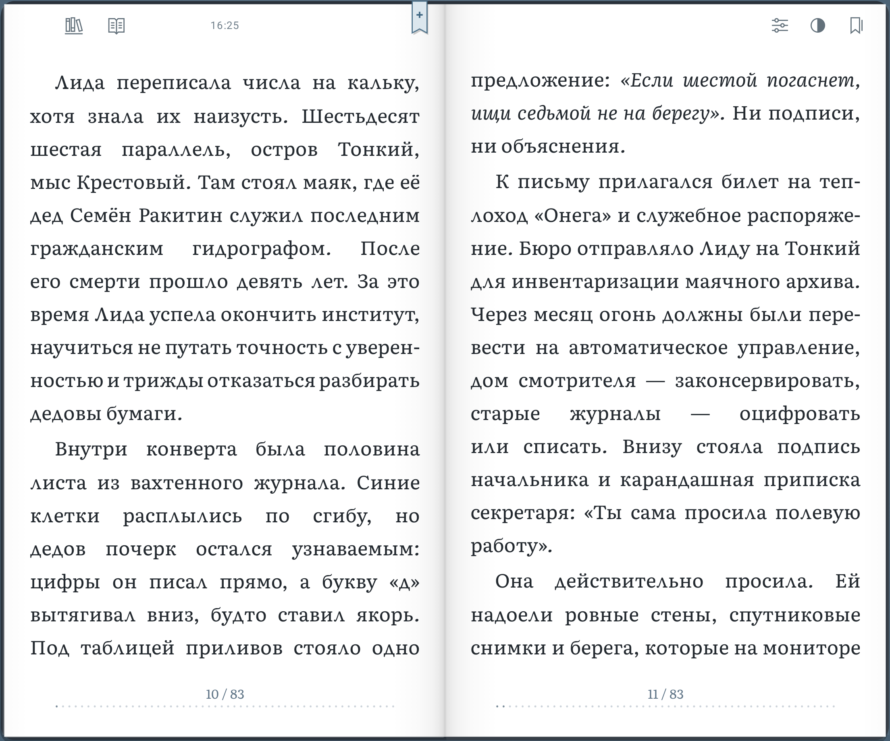
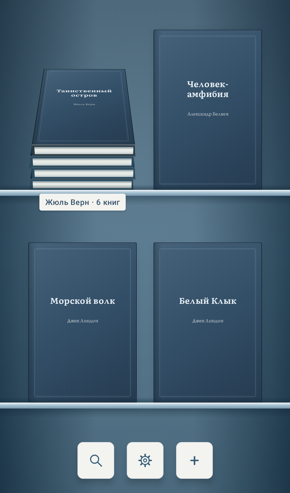
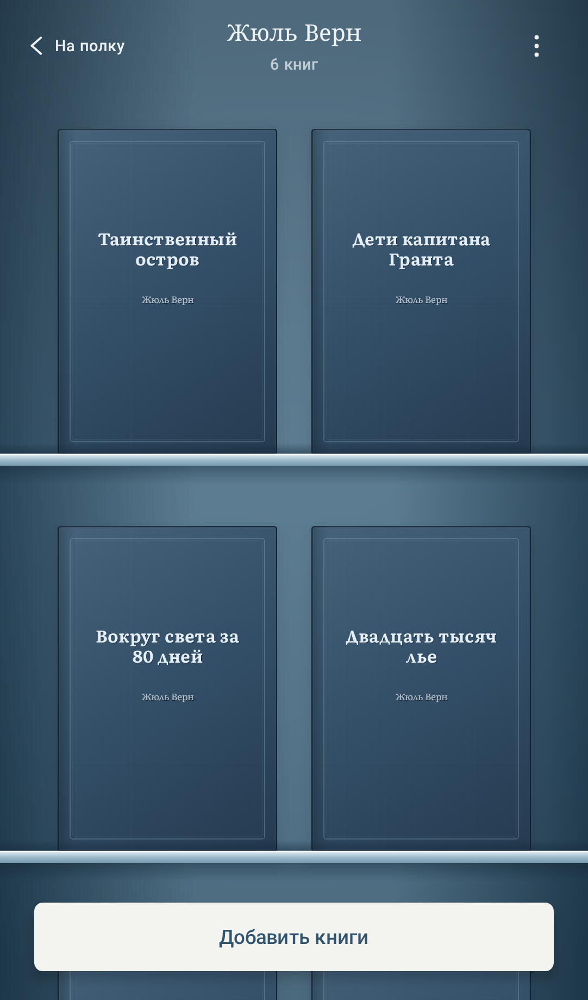
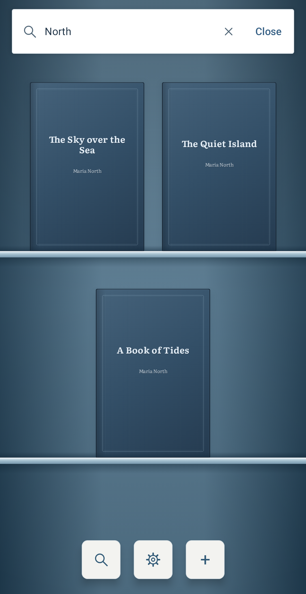
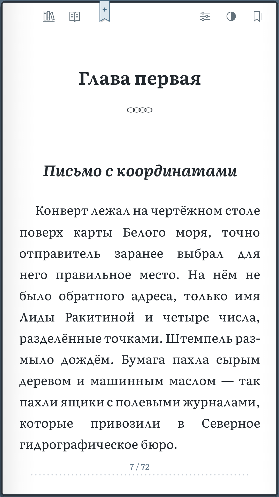
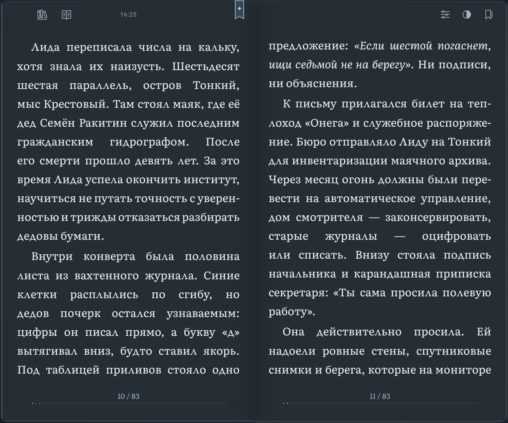
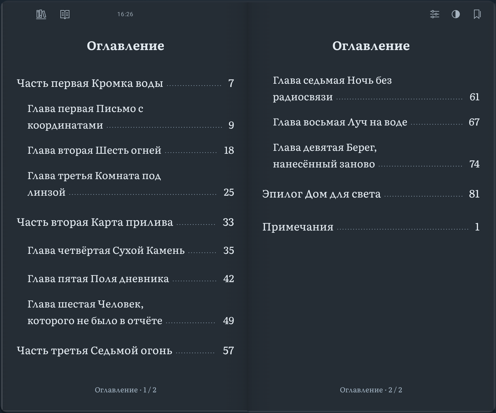

# Листай / Turn the Page

Листай — Android-читалка, которая старается сохранить ощущение настоящей книги:
сине-серый матовый шкаф, холодная чистая бумага, жёсткая обложка, корешок и
мягкое физическое перелистывание. Управление напечатано на обложке, страницах и
небольшой бумажной вкладке внутри книги.

На Fold и широком экране — полноценный двустраничный разворот. На телефоне —
одна страница, которая занимает экран целиком. Без рекламы, аккаунтов и телеметрии.

Текущая версия проекта — **1.5**, Android 8.0+.
[Что нового в 1.5](docs/releases/1.5.md).

[Скачать опубликованный APK 1.1](https://sourcecraft.dev/avstaim/listai/releases/v1.1)
· [Изменения 1.1](docs/releases/1.1.md).
Код версии 1.5 находится в `main`; её APK ещё не опубликован в релизах.

[Конфиденциальность](docs/privacy.md) · [Условия использования](docs/terms.md)
· [Лицензии](docs/licenses.md)

Код — [Apache-2.0](LICENSE); собственные книга, иллюстрации и скриншоты —
[CC-BY-4.0](LICENSES/CC-BY-4.0.txt). Шрифт «Плёс» сохраняет SIL OFL-1.1.
Область действия и сторонние уведомления указаны в [NOTICE](NOTICE).



## 1.5

Библиотека стала удобнее для большой коллекции, а оформление текста — ближе
к бумажному изданию. Версия приложения — `1.5`, `versionCode = 28`.

- Поиск книг по названию и автору, включая книги внутри стопок. Открывается
  кнопкой поиска или свайпом полки вниз; пустой поиск закрывается при прокрутке
  к следующим книгам. Поиск работает только в библиотеке.
- Три масштаба полки: близкий, средний и далёкий. Сведите пальцы, чтобы отдалить
  полку, или разведите, чтобы приблизить.
- Стопки для книг одного автора, серии или жанра. Перетащите книгу на другую,
  задайте имя и соберите стопку; добавляйте книги перетаскиванием или из меню.
  Внутри можно менять порядок и возвращать книги на общую полку.
- Полка с отдельными кнопками поиска, настроек и импорта. Подписи остаются
  только у стопок; названия и авторы книг видны на обложках.
- Описание на страницах выбранной темы, титульный лист и постоянное оглавление.
  Главы начинаются с новой страницы с векторным украшением; части получают
  отдельные титулы, эпилог — оформление без номера главы. Титул книги и части
  открываются справа в развороте; на телефоне служебные пустые листы пропускаются.
- Небольшие часы у верхнего края бумаги, которые можно отключить в настройках чтения.
- Просмотр иллюстраций на весь экран: касание открывает изображение, два пальца
  или двойное касание меняют масштаб. Удержание позволяет временно рассмотреть детали.

[Полное описание 1.5](docs/releases/1.5.md).

## Возможности

- FB2, FB2.ZIP, EPUB и PDF, безопасный импорт и собственная копия файла;
- массовый импорт файлов и папок, перестановка книг на полке и обмен исходным файлом;
- реальная обложка книги на полке, во время подъёма и в ридере;
- одна страница на телефоне и разворот на Fold и широком экране с учётом сгиба и вырезов;
- бумажная вкладка с размером текста, светлой/тёмной/системной темой,
  оглавлением, закладками и точным переходом по книге;
- книжная гарнитура «Плёс» и полноценная демонстрационная книга с сюжетом,
  описанием, главами, оглавлением, иллюстрациями и примечаниями;
- книжное оформление FB2 и EPUB; PDF сохраняет исходную вёрстку;
- сноски с точным возвратом к месту вызова, сохранение прогресса и закладок;
- разноцветные закладки и быстрое добавление с верхнего края страницы с учётом
  реального выреза камеры;
- русский и английский интерфейс, Room/DataStore и восстановление состояния.

## Скриншоты

| Полка и стопки | Внутри стопки | Поиск по библиотеке |
| --- | --- | --- |
|  |  |  |

| Чтение на телефоне | Титульная страница | Иллюстрация на весь экран |
| --- | --- | --- |
|  |  |  |

| Графитовая бумага | Постоянное оглавление |
| --- | --- |
|  |  |

Чтение, титул, развороты и оглавление сняты в версии 1.5 на Android-эмуляторе.
Библиотека и просмотр иллюстрации — проверенные рендеры компонентов приложения
с демонстрационными данными. [Источники изображений](docs/images/README.md).
Демонстрационный рассказ, обложки и иллюстрации созданы для проекта.

Если заметили проблему, приложите
версию Android, размеры/ориентацию окна и шаги воспроизведения. Книгу целиком
прикладывать не обязательно: достаточно минимального разрешённого к передаче фрагмента.

## Быстрый старт

Нужны Android SDK с API 36 и JDK 17 или новее. Из корня проекта:

```bash
./gradlew assembleDebug
```

APK появится в `app/build/outputs/apk/debug/`. Версия задаётся в
`gradle.properties` свойствами `listai.versionName` и `listai.versionCode`.

Основные проверки:

```bash
./gradlew test
./gradlew lintRelease
./gradlew :feature:reader:validateDebugScreenshotTest
./gradlew :feature:library:validateDebugScreenshotTest
./gradlew connectedDebugAndroidTest
```

Эталонные screenshot-файлы обновляйте только после визуальной проверки:

```bash
./gradlew :feature:reader:updateDebugScreenshotTest :feature:library:updateDebugScreenshotTest
```

Выпуск и постоянная подпись APK выполняются по [навыку выпуска](.agents/skills/listai-release/SKILL.md).
Подробности локальной упаковки — в [release-build.md](docs/release-build.md),
процедура SourceCraft — в [sourcecraft-release.md](docs/sourcecraft-release.md).

## Архитектура

```text
:core:model
├── :format:fb2 / :format:epub / :format:pdf (Android)
├── :reader:pagination
│   └── :reader:rendering
├── :core:database
├── :core:files (форматы, SAF, частные копии)
├── :feature:library (database, designsystem, files)
└── :feature:reader (adaptive, designsystem, pagination, rendering)

:app собирает feature-модули и application-lifetime зависимости
```

`:format:fb2` читает формат и отдаёт формат-независимый `BookDocument`.
`:reader:pagination` строит страницы, а `:reader:rendering` содержит чистую
геометрию curl. Android measurement, surface cache и rasterization находятся в
`:feature:reader`; Compose-модули показывают книгу и шкаф. `:core:files` отвечает
за безопасное хранение и импорт, `:core:database` — за Room, прогресс и
настройки. `:app` связывает жизненный цикл, навигацию и экранные состояния.

Проект рассчитан на совместную разработку: правила репозитория находятся в
`AGENTS.md`, а узкие рабочие инструкции — в `.agents/skills/`. Это инструменты
сборки и сопровождения проекта, а не функции приложения.

## История

- [1.1 — EPUB, PDF и большая библиотека](docs/releases/1.1.md)
- [1.0 — первый стабильный релиз](docs/releases/1.0.md)
- [0.9 — исторический релиз](docs/releases/0.9.md)
- [0.8.1 — исторический релиз](docs/releases/0.8.1.md)
