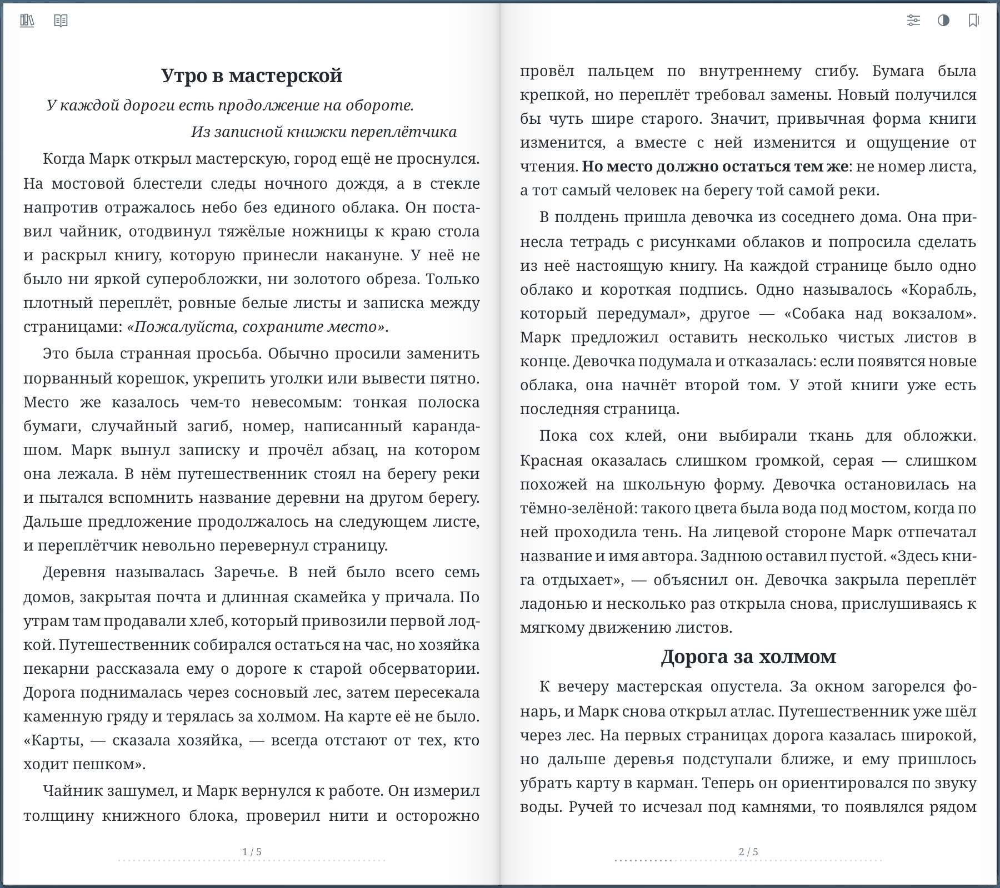
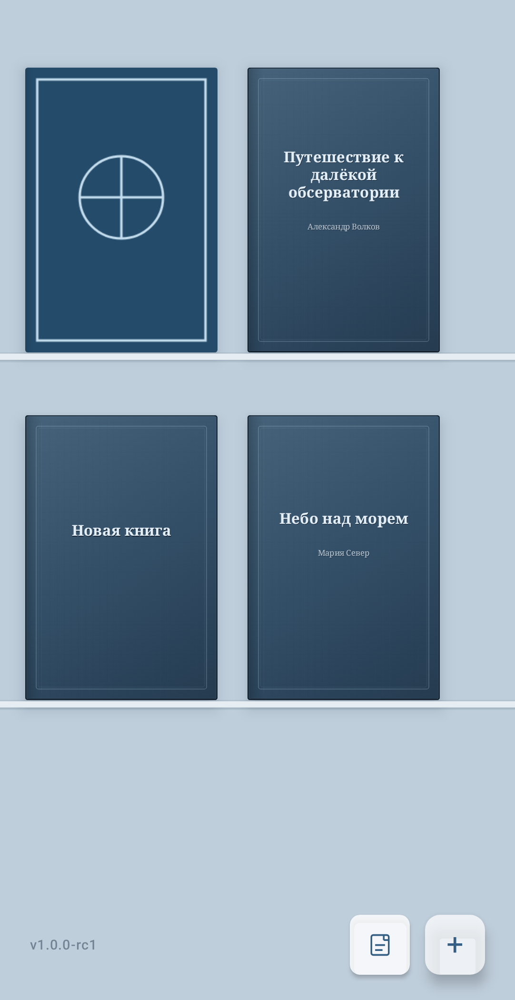
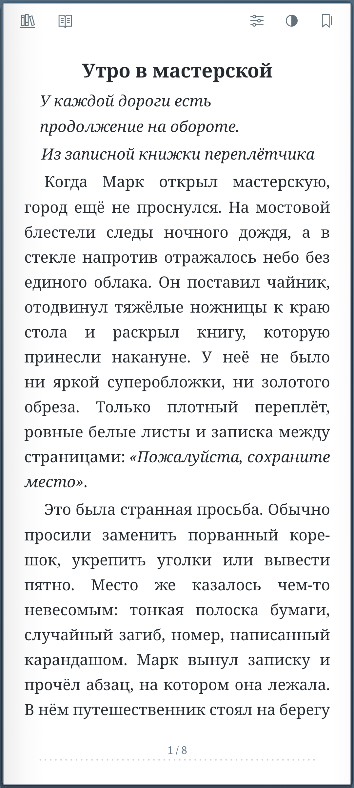
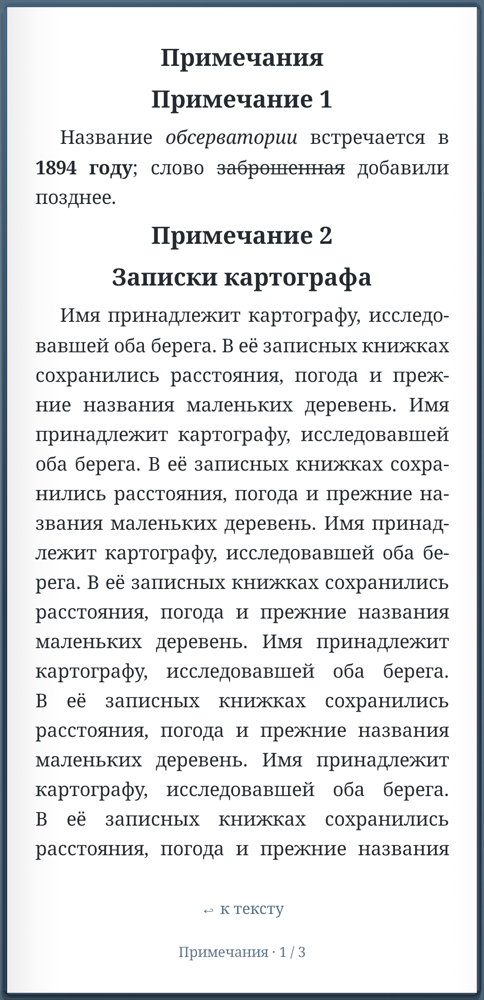
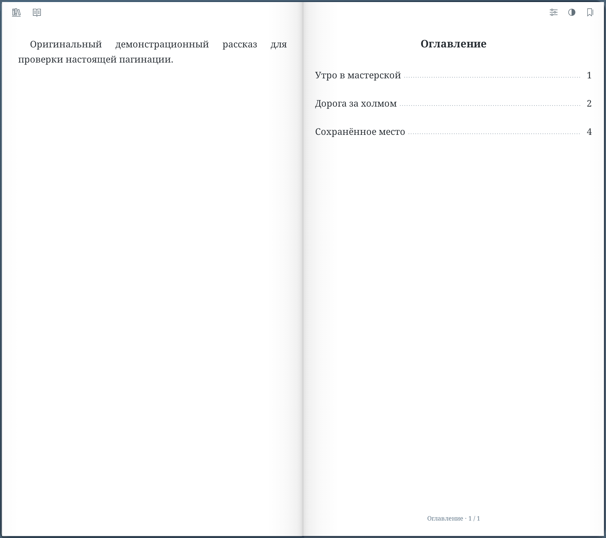
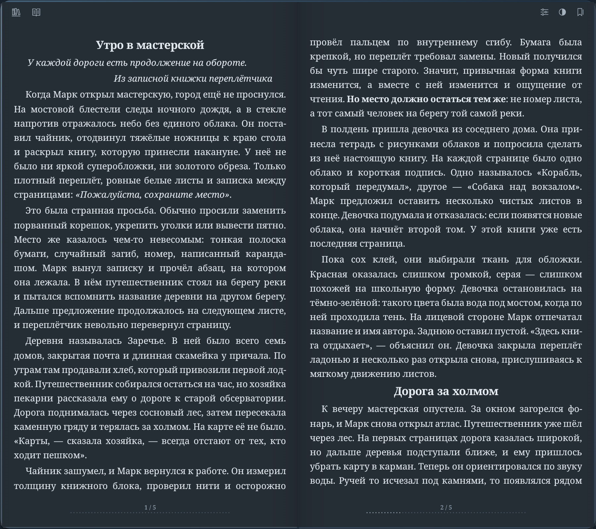

# Листай / Turn the Page

Листай — Android-читалка, которая старается сохранить ощущение настоящей книги:
сине-серый матовый шкаф, холодная чистая бумага, жёсткая обложка, корешок и
мягкое физическое перелистывание. Вместо панели управления — небольшая бумажная
вкладка внутри книги.

На Fold и широком экране — полноценный двустраничный разворот. На телефоне —
одна страница, которая занимает экран целиком. Без рекламы, аккаунтов и телеметрии.

[Скачать APK 1.1](https://sourcecraft.dev/avstaim/listai/releases/v1.1)
· Android 8.0+ · [Что нового](docs/releases/1.1.md)

[Конфиденциальность](docs/privacy.md) · [Условия использования](docs/terms.md)
· [Лицензии](docs/licenses.md)

Код — [Apache-2.0](LICENSE); собственные книга, иллюстрации и скриншоты —
[CC-BY-4.0](LICENSES/CC-BY-4.0.txt). Шрифт «Плёс» сохраняет SIL OFL-1.1.
Область действия и сторонние уведомления указаны в [NOTICE](NOTICE).



## 1.1

Последний опубликованный выпуск — **1.1**, `versionCode = 15`.
[Изменения 1.1](docs/releases/1.1.md): EPUB и PDF, перетаскивание книг,
обмен исходным файлом и массовый импорт папок. Исправлены цвета тёмной темы,
перелистывание назад на телефоне и мигание значка закладки.

[Заявка на включение 1.1 в F-Droid](https://gitlab.com/fdroid/fdroiddata/-/merge_requests/50461)
отправлена и ожидает проверки. [Рецепт, результаты сборки и особенности подписи](docs/fdroid.md).

Возможности приложения:

- FB2, FB2.ZIP, EPUB и PDF, безопасный импорт и собственная копия файла;
- массовый импорт файлов и папок, перестановка книг на полке и обмен исходным файлом;
- реальная обложка книги на полке, во время подъёма и в ридере;
- полка, которая прокручивается только при переполнении реальными книгами;
- single/spread для телефона, Fold и широкого окна с безопасным учётом hinge и вырезов;
- бумажная вкладка с размером текста, светлой/тёмной/системной темой,
  оглавлением, закладками и точным переходом по книге;
- книжная гарнитура «Плёс» и полноценная демонстрационная книга с сюжетом,
  описанием, главами, оглавлением, иллюстрациями и примечаниями;
- аннотация FB2 на отдельном белом листе в single и на внутренней стороне
  жёсткой обложки в spread, включая длинные продолжения;
- сноски с точным возвратом к месту вызова, сохранение прогресса и закладок;
- разноцветные закладки и быстрое добавление с верхнего края страницы с учётом
  реального выреза камеры;
- русский и английский интерфейс, Room/DataStore и восстановление состояния.

| Книжный шкаф | Чтение на телефоне | Примечания |
| --- | --- | --- |
|  |  |  |

| Аннотация и оглавление | Тёмный разворот |
| --- | --- |
|  |  |

Чтение, разворот и оглавление сняты на эмуляторе. Шкаф и примечания —
скриншоты production-компонентов из воспроизводимых UI-fixtures. Все демонстрационные
тексты и обложки созданы для проекта. [Полное описание версии](docs/releases/1.1.md).

Если заметили проблему, приложите
версию Android, размеры/ориентацию окна и шаги воспроизведения. Книгу целиком
прикладывать не обязательно: достаточно минимального разрешённого к передаче фрагмента.

## Быстрый старт

Нужны Android SDK с API 36 и JDK 17 или новее. Из корня проекта:

```bash
./gradlew assembleDebug
```

APK появится в `app/build/outputs/apk/debug/`. Версия задаётся в
`gradle.properties` свойствами `listai.versionName` и `listai.versionCode`.

Основные проверки:

```bash
./gradlew test
./gradlew lintRelease
./gradlew :feature:reader:validateDebugScreenshotTest
./gradlew :feature:library:validateDebugScreenshotTest
./gradlew connectedDebugAndroidTest
```

Эталонные screenshot-файлы обновляйте только после визуальной проверки:

```bash
./gradlew :feature:reader:updateDebugScreenshotTest :feature:library:updateDebugScreenshotTest
```

Выпуск и постоянная подпись APK выполняются по [навыку выпуска](.agents/skills/listai-release/SKILL.md).
Подробности локальной упаковки — в [release-build.md](docs/release-build.md),
процедура SourceCraft — в [sourcecraft-release.md](docs/sourcecraft-release.md).

## Архитектура

```text
:core:model
├── :format:fb2 / :format:epub / :format:pdf (Android)
├── :reader:pagination
│   └── :reader:rendering
├── :core:database
├── :core:files (форматы, SAF, частные копии)
├── :feature:library (database, designsystem, files)
└── :feature:reader (adaptive, designsystem, pagination, rendering)

:app собирает feature-модули и application-lifetime зависимости
```

`:format:fb2` читает формат и отдаёт формат-независимый `BookDocument`.
`:reader:pagination` строит страницы, а `:reader:rendering` содержит чистую
геометрию curl. Android measurement, surface cache и rasterization находятся в
`:feature:reader`; Compose-модули показывают книгу и шкаф. `:core:files` отвечает
за безопасное хранение и импорт, `:core:database` — за Room, прогресс и
настройки. `:app` связывает жизненный цикл, навигацию и экранные состояния.

Проект рассчитан на совместную разработку: правила репозитория находятся в
`AGENTS.md`, а узкие рабочие инструкции — в `.agents/skills/`. Это инструменты
сборки и сопровождения проекта, а не функции приложения.

## История

- [1.0 — первый стабильный релиз](docs/releases/1.0.md)
- [0.9 — исторический релиз](docs/releases/0.9.md)
- [0.8.1 — исторический релиз](docs/releases/0.8.1.md)
