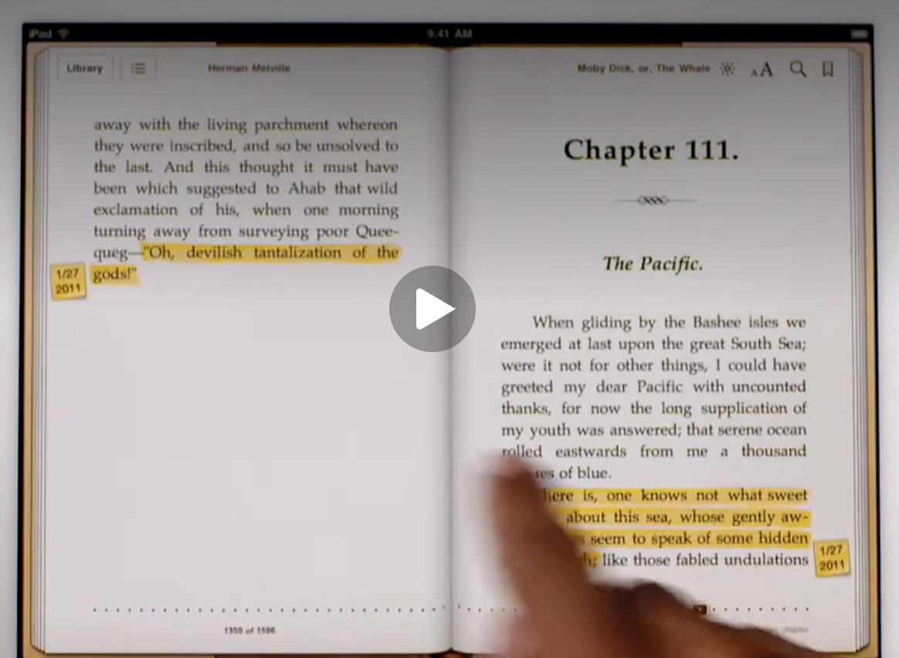
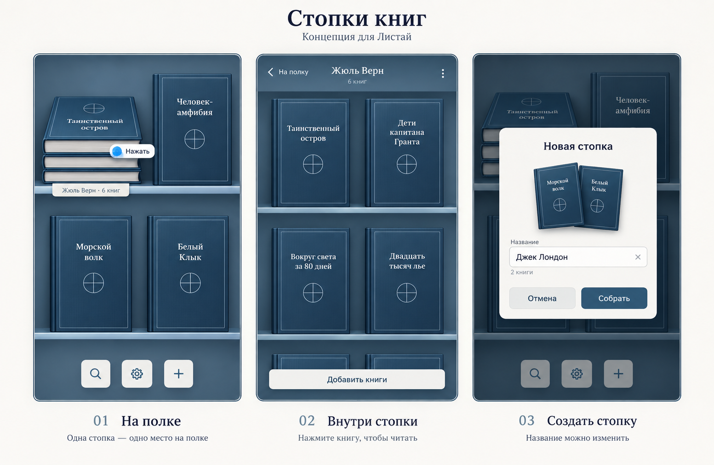
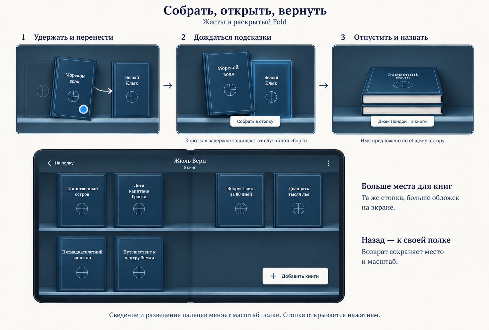

# Версия 1.2 — согласованные задачи

Статус: восемь функций реализованы и проверены; подготовлен локальный кандидат `1.2-rc1` (код 16). Дата: 2026-09-28.
Фактические результаты и артефакты: [отчёт проверки](v1.2-verification.md).

Порядок работ, владельцы файлов, параллельные пакеты и проверки:
[план выполнения 1.2](v1.2-execution.md).

Здесь собраны требования из обсуждения версии 1.2. UX стопок одобрен
пользователем после просмотра двух эскизов. Пасхалка «Библиотечный кот»
одобрена с фотографией кота в качестве прообраза. Восемь функций ниже составляют
объём версии. Разделы «Уточнения для реализации» фиксируют проектные решения,
принятые при финализации, а не дополнительные дословные пожелания пользователя.

## Общие границы и подтверждённые решения

- Пользователь подтвердил порядок: **обложка → описание → титульная страница
  → текст**. Если описания нет, этот шаг пропускается. Оглавление остаётся
  отдельным доступным разделом с возвратом; оно не разрывает эту цепочку.
- Обычное перелистывание описания, титула и текста не проходит через оглавление.
  Вход в оглавление сохраняет точное состояние входа; возврат восстанавливает
  его, а выбор главы переводит к исходному тексту.
- Пользователь подтвердил новую вёрстку для **FB2 и EPUB**. PDF сохраняет
  исходные страницы; синтетический титул и новое оформление глав в PDF
  не добавляются. Поиск в библиотеке, стопки, масштаб и часы доступны для книг
  всех поддерживаемых форматов.
- «Читать» и восстановление позиции ведут к сохранённому основному тексту,
  а не заставляют повторно проходить описание и титул. «Описание» ведёт
  непосредственно к описанию.
- По уточнению пользователя от 29 сентября описание, титул, основной текст
  и начала глав следуют выбранной светлой/графитовой теме. Внутренние стороны
  жёсткой обложки сохраняют цвет переплёта независимо от темы бумаги.
- Телефон, сложенный и раскрытый Fold; RU/EN, светлая/тёмная/системная тема,
  увеличенный системный шрифт. Размеры определяются доступным окном и hinge,
  а не названием устройства.
- Основной `BookLocation`, описание, титул, оглавление и возврат из примечания
  имеют независимое состояние. Служебные страницы не меняют смысловой прогресс
  исходного текста; существующие закладки и ссылки сохраняют свои цели.
- Векторные украшения и кот создаются как векторные исходники. Растровые
  спрайты/PNG вместо них не подходят. Подготовка целого листа в bitmap перед
  curl сохраняется: вектор заново рисуется под нужный размер, а не растягивается
  из маленькой растровой заготовки. Layout/decode в каждом кадре curl запрещены.
- Постоянная новая панель, поиск по тексту книги, автоматические/вложенные стопки,
  облачная синхронизация и новые форматы не входят в 1.2.
- После финализации требований пользователь поручил реализацию субагентам,
  отдельные локальные коммиты и подписанный APK для проверки. Этот запрос
  разрешает локальную сборку `1.2-rc1` / 16. Push, теги и публикация запрещены.

## 1. Поиск книг в библиотеке

- Поиск открывается через иконку внизу экрана или свайп вниз по полке с книгами.
- Поиск работает только в библиотеке. Поиска внутри открытой книги в этой
  версии задачи нет.
- Книги внутри стопок также находятся общим поиском; результат показывает
  принадлежность, например «В стопке „Фантастика“».

### Уточнения для реализации

- Поиск локальный и глобальный по всей библиотеке, в том числе при запуске
  из открытой стопки. Поля: название книги, авторы, известное название серии.
- Регистр, повторные пробелы и различие `е/ё` не влияют на результат.
  Все слова запроса должны встречаться в совокупности этих полей. Поиск
  не обращается к сети и не парсит исходники при вводе каждой буквы.
- Пустой запрос показывает все книги в стабильном порядке обхода полки
  и содержимого стопок, без дубликатов. Для нулевого результата есть явное
  сообщение. Импорт/удаление обновляет результаты.
- Свайп открывает поиск только новым движением вниз от верхней границы списка;
  обычная прокрутка к началу его не вызывает. Иконка и жест открывают один UI.
- Книга, открытая из поиска, возвращается к запросу и результатам. Закрытие
  поиска возвращает к исходной полке/стопке. Перестановка в результатах
  отключена. Back сначала закрывает клавиатуру, затем поиск.

## 2. Часы при чтении

- Маленькие, ненавязчивые часы на панели при чтении.
- Часы можно отключить в настройках.

### Уточнения для реализации

- По умолчанию включены; настройка общая для всех книг и сохраняется
  после перезапуска, остальные настройки не сбрасываются.
- Часы размещаются в существующей области печатных верхних действий.
  Время локальное, формат 12/24 часа системный; без секунд и мигания.
- Обновление по минутам и при изменении системного времени/часового пояса;
  оно не запускает пагинацию или повторную подготовку страниц.
- Выключенные/невидимые часы и приложение в фоне не поддерживают таймер.
  Текст часов не пересекает кнопки, книжный текст, камеру или hinge.

## 3. Описание книги

- В раскрытом Fold описание начинается с бумажной страницы выбранной темы,
  как на телефоне и сложенном Fold.
- На внутренней стороне обложки в раскрытом Fold располагается меню,
  как на закрытой книге.
- В начале описания добавляется заголовок «Описание» на телефоне и Fold.

### Уточнения для реализации

- Заголовок «Описание» / `Description` печатается в начале раздела один раз.
  Длинное описание продолжается на бумажных листах той же выбранной темы.
- При отсутствии описания нет пустой страницы и неработающего действия.
- Меню внутри обложки Fold повторяет действующие команды закрытой книги;
  оно принадлежит жёсткой обложке и не перехватывает чтение соседней страницы.
- Перелистывание, поворот, изменение шрифта, Fold и восстановление процесса
  сохраняют место в описании отдельно от основного места чтения.

## 4. Титульная страница

- Визуальный ориентир — предоставленный пользователем скриншот iBooks
  с титульной страницей «The Picture of Dorian Gray».
- Белый фон в светлой теме, графитовый в тёмной; чернила также следуют теме.
- Крупное название книги по центру; ниже — автор.
- Небольшой декоративный разделитель, много свободного пространства
  и спокойная книжная типографика.
- Разделитель обязательно векторный, а не растровый: он должен сохранять
  чёткость при любом размере и соотношении сторон страницы.

### Уточнения для реализации

- Титул идёт после описания. Используются имеющиеся название и авторы;
  отсутствующий автор пропускается, издательство и другие данные не выдумываются.
- Длинные название/список авторов переносятся без обрезки: сначала сокращаются
  декоративные отступы; для экстремального объёма допустимо продолжение
  служебного раздела вместо потери текста.
- Явно обозначенный в источнике титул используется без второй синтетической
  копии, с сохранением исходных anchors. По одному совпадению текста с названием
  книги исходные блоки не удаляются. При отсутствии надёжной структурной метки
  создаётся служебный титул, исходный текст сохраняется полностью.
- Распознанный исходный титул показывается один раз, в служебной проекции;
  повтор тех же блоков в основном потоке исключается только при отображении.
  Исходные блоки, IDs и UTF-16 offsets сохраняются. Старые ссылки, закладки
  и сохранённые позиции внутри такого титула разрешаются в его видимую проекцию.
- Титул имеет собственную восстанавливаемую позицию, не заменяет annotation
  anchor и не увеличивает процент прочитанного основного текста.

## 5. Начало новой главы

- Каждая глава начинается с новой страницы.
- Сверху по центру располагается номер главы, ниже — декоративный разделитель
  и название главы, если оно есть.
- Основной текст начинается ниже, с увеличенным отступом.
- Разделитель и украшения обязательно векторные, чёткие при любом размере
  страницы.
- Визуальный ориентир — предоставленный пользователем скриншот iBooks:
  «Chapter 111.», разделитель, «The Pacific.», затем основной текст.

### Уточнения для реализации

- Глава определяется структурой документа (раздел, оглавление, связанный
  заголовок), а не каждым `Heading`. Несколько абзацев одного FB2 `title`
  образуют один заголовок главы.
- Сохраняется явный номер из источника, в том числе римский или словесный.
  При отсутствии номера используется порядковый номер распознанной главы.
  Номер не дублируется второй раз в названии.
- Части, пролог/эпилог, вложенные подзаголовки, примечания и служебные страницы
  не получают номер главы автоматически. При неоднозначной структуре
  сохраняется исходный заголовок без выдуманной семантики.
- Новая страница не обязана быть правой в развороте: пустые листы для этого
  не вставляются. Заголовок и украшение удерживаются вместе с началом текста
  или первым содержательным блоком главы, пока они помещаются на странице
  после сокращения декоративных отступов.
- Длинный заголовок не обрезается; декоративные отступы уступают место тексту.
  Если сам заголовок длиннее страницы, он продолжается на следующей,
  украшение печатается один раз, текст следует за завершением заголовка.
  Последний фрагмент по возможности объединяется с началом текста. Большой
  неделимый первый блок также может перейти на следующую страницу. Пагинация
  обязана продвигаться и не создавать бесконечные пустые страницы.
- Исходные IDs/UTF-16 offsets, ссылки TOC, закладки и сноски сохраняются.
- Правило применяется в пагинации как без сносок, так и с ними.

## 6. Масштаб полки

- Три уровня: крупный / близкий, средний, мелкий / далёкий.
- Текущий вид полки соответствует среднему уровню.
- Сведение двух пальцев отдаляет, разведение приближает.
- Масштабирование работает и для полки с книгами, и для стопок.

### Уточнения для реализации

- Средний — точная текущая геометрия полки, а также начальный уровень.
  Выбор общий для библиотеки и раскрытых стопок, сохраняется после перезапуска.
- Pinch дискретно переключает соседние уровни, с порогом и гистерезисом против
  дрожания. На крайних уровнях дальнейший жест не меняет масштаб.
- Перераскладка удерживает видимую книгу/стопку по устойчивому ID, а не номеру
  ряда. Масштаб не меняет порядок и принадлежность книг.
- Второй палец отменяет незавершённые tap/drag без записи перестановки или
  создания стопки. Для доступности имеются действия увеличить/уменьшить.

## 7. Стопки книг — одобренный UX

Стопки позволяют вручную объединять книги, например по автору, серии, жанру
или собственному принципу («На отпуск», «Любимое»).

### Внешний вид

- Стопка выглядит как физический предмет: несколько книг лежат друг на друге,
  сверху видна обложка, на краю полки — бумажная подпись с названием и числом
  книг, например «Жюль Верн · 6 книг».
- Стопка занимает место одной обычной книги.
- Достаточно нескольких видимых слоёв независимо от количества книг;
  фактическое количество показывает счётчик.
- На всех трёх уровнях масштаба сохраняются узнаваемый силуэт, название
  и счётчик.
- Первая книга внутри стопки определяет её верхнюю обложку.

### Создание

Два равноправных способа:

1. Удержать книгу, перенести на центр другой и немного задержаться.
   Появляются подсветка, лёгкая вибрация и подсказка «Собрать в стопку».
   После отпускания предлагается название.
2. В меню книги выбрать «Собрать в стопку», отметить другие книги и задать
   название. В выборе можно отмечать сразу несколько книг по автору, серии
   или жанру.

Название предлагается по общей серии или автору. Пользователь может заменить
его любым своим названием.

### Открытие, чтение и возврат

- Нажатие на стопку раскрывает её: книги немного расходятся и занимают
  отдельные места на просторной полке.
- Сверху видны название стопки, количество книг и меню.
- Нажатие на отдельную книгу открывает чтение.
- Возврат из чтения ведёт обратно в открытую стопку.
- «На полку» или системный жест назад сворачивает стопку и возвращает
  к её прежнему месту в библиотеке, сохраняя позицию и масштаб.

### Добавление, извлечение и порядок

- Добавить книгу можно перетаскиванием на стопку или через «Добавить книги»
  внутри неё.
- В меню книги внутри стопки есть «Вернуть на полку» и перемещение в другую
  стопку.
- Извлечённая книга появляется рядом со стопкой.
- Книги внутри можно переставлять перетаскиванием; изменение первой книги
  меняет верхнюю обложку закрытой стопки.
- Саму стопку можно переставлять на общей полке.
- Состав стопок меняет пользователь; новые книги автоматически в них
  не перемещаются.

### Разбор и отмена

- Команда «Разобрать стопку» возвращает все её книги на место стопки
  в библиотеке с сохранением внутреннего порядка.
- Разбор стопки сохраняет книги в библиотеке.
- После перемещений и разбора доступно «Отменить».

### Модель принадлежности и поиск

- Книга находится либо на общей полке, либо в одной стопке.
- Вложенных стопок нет.
- Общий поиск охватывает все книги и показывает название стопки у найденной
  книги, если она находится внутри неё.

### Жесты и Fold

- Перенос между книгами отвечает за перестановку; короткая задержка над
  центром обложки включает сборку стопки с явной подсказкой до отпускания.
- Сведение и разведение пальцев всегда меняет масштаб полки.
- Свайп вниз остаётся жестом поиска в библиотеке.
- Стопка открывается обычным нажатием, без отдельного жеста масштабирования.
- На раскрытом Fold используется то же взаимодействие; просторная полка
  внутри стопки показывает больше отдельных обложек.
- При складывании сохраняются открытая стопка и позиция просмотра.

### Уточнения для реализации

- Новая стопка создаётся минимум из двух книг. Отмена ввода имени не меняет
  полку. Предложение имени: общая серия, затем общий автор, затем «Новая стопка».
- В меню стопки есть переименование. Имя обрезается по краям от пробелов,
  должно быть непустым; верхняя граница — 120 символов. Одинаковые имена
  допустимы: стопки различаются устойчивыми ID.
- Если осталась одна книга, стопка сохраняет имя. После извлечения/удаления
  последней книги пустая стопка исчезает в той же транзакции.
- Выбор книг показывает реальные метаданные и текущее членство. Перенос
  из другой стопки перемещает книгу, не создаёт копию. Без серии/жанра книга
  остаётся доступной для ручного выбора; метаданные не угадываются по названию.
- Серия, жанры и отдельные авторы сохраняются при импорте. Уже импортированные
  книги получают эти данные из своих частных копий в фоне; одна ошибка
  не блокирует библиотеку и не сбрасывает BookId/прогресс.
- Новая импортированная книга попадает на общую полку, даже если открыта
  стопка. Чтение не переставляет книги и стопки.
- «Отменить» относится к последней структурной операции в текущем сеансе,
  пока показано сообщение об отмене. Следующая структурная операция заменяет
  его; бессрочная история и отмена после перезапуска не обещаются.
- Отмена восстанавливает только расположение/членство, не откатывает свежий
  прогресс, закладки или импорт и не воскрешает удалённую книгу. Если внешнее
  изменение делает отмену неприменимой, действие снимается безопасно.
- Порядок, состав и имена стопок сохраняются на диске атомарно. Навигационный
  контекст и видимые элементы восстанавливаются при Fold/Activity recreation.
  После холодного запуска сохраняются масштаб и выбранная книга по прежнему
  правилу приложения; временный поиск и Undo могут быть закрыты. Возврат
  из восстановленного чтения ведёт в существующую стопку книги или на полку.

### Одобренные эскизы

Эскизы созданы через `imagegen` для обсуждения UX с опорой на визуальный стиль
существующей библиотеки. Это концепты будущего интерфейса, а не скриншоты
реализованных функций или эталоны screenshot-тестов. Требования выше определяют
поведение; примерные книги, декоративные детали и размеры на эскизах
иллюстрируют концепцию.

## 8. Пасхалка «Библиотечный кот» — одобрена

Незаметный обитатель библиотеки, который появляется в ответ на скрытый жест.

### Поведение

- Несколько нажатий по пустому месту на полке вызывают кота.
- Кот осторожно выглядывает из-за книг, осматривается, забирается на ближайшую
  стопку и сворачивается клубком. Если стопок нет, устраивается рядом с книгами.
- При нажатии на кота он приоткрывает один глаз, лениво машет хвостом
  и снова засыпает.
- При открытии книги кот тихо скрывается за полкой.
- Пасхалка работает без звуков и надписей; её характер передают движения.

### Образ и оформление

- Прообраз — кот на предоставленной пользователем фотографии ниже.
- Узнаваемые черты: полосатая шубка, сонный прищур, расслабленная лежачая поза
  и длинный свисающий хвост.
- Графика лаконичная и векторная: силуэт с характерными деталями прообраза.
- В светлой теме кот графитовый, в тёмной — дымчато-серый.
- Фотография сохраняется как референс для будущего рисунка; она не является
  готовым графическим ресурсом интерфейса.

### Уточнения для реализации

- Начальный порог — пять коротких нажатий за три секунды в одной свободной
  области. Движение, второй палец, нажатие на книгу/кнопку или переход
  в поиск сбрасывают последовательность. Кот не вызывается случайно
  прокруткой, масштабированием или перестановкой.
- Одновременно существует один кот. Повторный вызов не создаёт второго.
  При смене масштаба/раскладки положение пересчитывается по опорной книге
  или стопке; при исчезновении опоры кот уходит.
- Кот не перекрывает названия, действия и зоны открытия книг, не пересекает
  hinge; на пустой полке может появиться из-за края полки.
- Спящий кот статичен. При открытии книги, уходе в фон или отключении ввода
  библиотеки работа анимации прекращается. Выключенные системные анимации
  учитываются. После перезапуска кот скрыт до нового вызова.
- Точные траектории и пороги жестов можно настроить по результатам визуальной
  проверки, сохраняя описанное взаимодействие.

## Критерии приёмки версии

Все пункты ниже остаются невыполненными до реализации и проверки.

| ID | Обязательный результат |
| --- | --- |
| A1 | Иконка и корректный pull-down открывают один глобальный поиск; найдена книга внутри стопки; ввод и Back не конфликтуют с жестами. |
| A2 | Часы ненавязчивы, переключаются и сохраняют настройку; минута/смена зоны не вызывают репагинацию, в фоне таймер не работает. |
| A3 | Описание с заголовком следует теме бумаги на телефоне и Fold; меню на внутренней обложке сохраняет цвет переплёта; длинное описание восстанавливается точно. |
| A4 | Последовательность обложка → описание → титул → текст соблюдается; титул масштабируется, сохраняет длинные данные и отдельную позицию. |
| A5 | Распознанные главы начинаются с новой страницы; номер/название не дублируются, украшения векторные; сноски, TOC и закладки ведут к прежнему тексту. |
| A6 | Есть ровно три устойчивых масштаба; средний соответствует 1.1, смена масштаба и Fold сохраняет видимый предмет и порядок. |
| A7 | Создание обоими способами, добавление, извлечение, перенос, переименование, перестановка, разбор и Undo работают без потери книг/прогресса. |
| A8 | Векторный кот узнаваем по референсу, вызывается только скрытым жестом, реагирует на нажатие и прекращает анимацию вне библиотеки. |
| A9 | Обновление базы 1.1 и всех поддерживаемых старых схем сохраняет книги, частные файлы, порядок, прогресс, TOC/описание и закладки; close/reopen и перезапуск процесса подтверждены. |
| A10 | FB2/EPUB получили новую вёрстку; исходные страницы и anchors PDF не изменены. RU/EN, темы, крупный шрифт и безопасные поля проверены. |
| A11 | Полный host gate и затронутые сценарии API 26/36 пройдены; screenshot actual/diff осмотрены до обновления эталонов; Fold проверен отдельно. |

Итог приёмки с командами, результатами, изображениями и ограничениями:
[docs/v1.2-verification.md](v1.2-verification.md).
